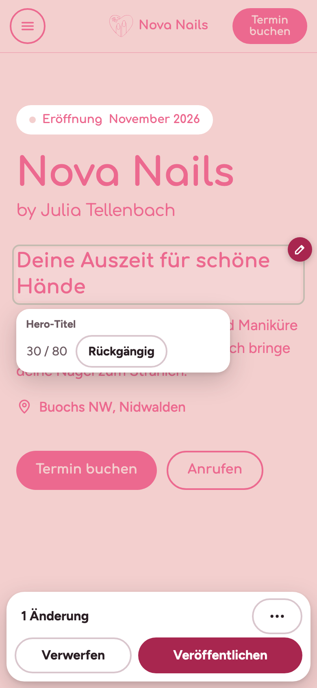
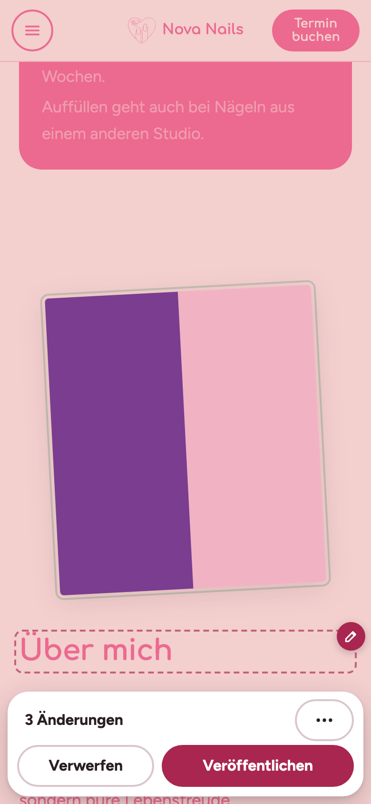
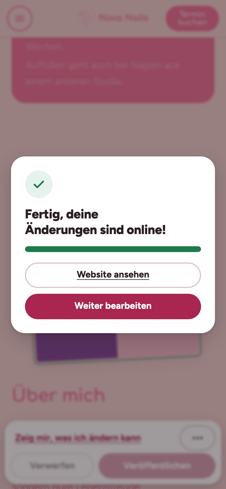

# So änderst du deine Website selbst

Öffne **deine-website.ch/bearbeiten** (am Handy oder am Computer) und melde dich mit deiner E-Mail und deinem Passwort an. Du bleibst 30 Tage angemeldet.

## 1. Antippen und tippen
Tippe auf einen Text oder einen Preis. Der Cursor erscheint, und du kannst direkt schreiben. Unter dem Text siehst du, wie viel Platz noch ist, und kannst mit **Rückgängig** alles zurücksetzen.

- **Preis:** nur die Zahl ändern, z. B. 45.
- **Foto:** auf dein Foto tippen → **Foto ersetzen** → Foto auswählen oder neu aufnehmen. Danach den Ausschnitt mit dem Finger verschieben und auf **Foto übernehmen** tippen.
- Nicht sicher, was sich ändern lässt? Unten auf **Zeig mir, was ich ändern kann** tippen.

## 2. Veröffentlichen
Unten siehst du, wie viele Änderungen du gemacht hast. Wenn alles passt, tippe auf **Veröffentlichen**. Mit **Verwerfen** machst du alles rückgängig.

Tipp: Sammle mehrere Änderungen und veröffentliche sie zusammen.

## 3. Fertig
Nach etwa einer Minute sind deine Änderungen online.

## Wenn etwas nicht klappt
- **Keine Verbindung:** Deine Änderungen bleiben gespeichert, auch wenn du die Seite schliesst. Versuch es einfach etwas später nochmal.
- **Passwort vergessen:** Schreib Ramon, er setzt es dir neu.
- **«Das hat nicht geklappt»:** Deine Website bleibt wie vorher online, und Ramon bekommt automatisch eine Nachricht.
